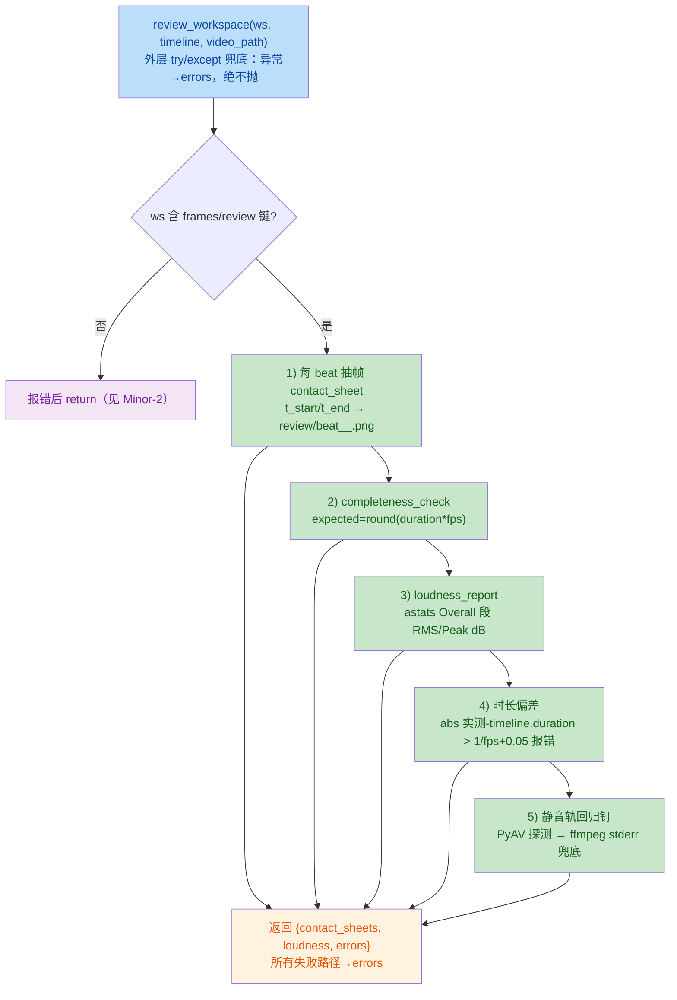

# Task 4 审查报告：质检工具（studio_review）

- 审查对象：commit `d1d7b24`（`backend/capabilities/video/services/studio_review.py` 360 行新增 + `backend/tests/test_studio_review.py` 86 行新增，`git show --stat` 确认仅含这两个文件）
- 审查依据：task-4-brief.md、task-4-report.md、task-4-review-package.md、落盘源码、依赖接口（`studio_assets.probe_duration` / `html_to_video.resolve_ffmpeg`）
- 审查方式：静态核实（未重跑测试，测试证据采信报告：RED ModuleNotFoundError ×5 → GREEN 5 passed → Task 1–3 回归 12 passed）

## 裁决

| 裁决项 | 结论 |
| --- | --- |
| ① 规格符合性 | ✅ 通过 |
| ② 代码质量 | 通过 |

发现统计：**Critical 0 · Important 0 · Minor 4 · 备注（可接受偏离）4**

## 变更意图与流程

意图：为 P2 创作 agent 实现「自查眼睛」——按 brief 契约实现 contact_sheet / loudness_report / completeness_check / review_workspace 四函数，防御式聚合进 errors，绝不抛异常。

## 规格符合性逐条核对

| 契约项 | 结论 | 证据 |
| --- | --- | --- |
| 四函数签名与 brief 逐字一致 | ✅ | `studio_review.py` L97-98 / L151 / L194 / L219 |
| `contact_sheet`：round(t*fps) 最近帧、列数 ceil(sqrt(n))、等比缩放 cell 宽、下标时间点 | ✅ | L116-132；`_nearest_frame`（L86-94）bisect 双候选，越界/缺号/负号均能取到（indices 非空则必有候选），并列取小号确定性 ✓ |
| `loudness_report`：astats 解析 RMS/Peak level dB，返回 3 键 | ✅ | L163-175，命令与 brief 一致（`astats=metadata=1 -f null -`）；`rfind("Overall")` 取末段 Overall 汇总，键名完整匹配 `RMS level dB`（规避 `RMS peak dB` 误匹配，L41 注释）；无 Overall 时回退全文 |
| `completeness_check`：缺号/0 字节/错误带帧号 | ✅ | L203-215 三类均带编号；目录缺失/expected 非法也返回错误而非抛异常 |
| `review_workspace`：beat 抽帧命名 beat_<id>_<t>.png、expected=round(duration*fps)、时长偏差 >1/fps+0.05、静音轨钉、返回 `{"contact_sheets","loudness","errors"}` | ✅ | L282-284（safe_id 清洗 + `beat_{id}_{ts:.2f}.png`）、L290、L309-313、L321-332、L230 |
| 防御式：任何环节失败进 errors，绝不抛异常 | ✅ | 每个 leaf 调用点独立 try/except + 外层兜底（L231-235）；空帧目录/坏视频/坏 timeline 三路径分别由 per-beat 捕获、响度+时长+音轨三处捕获、timeline 类型/字段校验覆盖 |
| ffmpeg 一律 resolve_ffmpeg，无硬编码 | ✅ | L31/L69/L160，无其他 ffmpeg 路径字面量 |
| 平台层无产品风格常量 | ✅（见备注 3） | contact_sheet 的底色/标注色是质检图自身版式，不入片 |
| Windows 编码安全：重定向文件 + errors="replace"，禁 shell=True | ✅ | L55-64（tempfile + 二进制写 + `read_text(errors="replace")`）；全部 str 列表参数，无 shell=True；与 studio_assets 既有约定一致 |
| brief Step 1 测试逐字采用 | ✅ | `test_studio_review.py` L1-19 与 brief 逐字一致 |

## 自定决策核实：-inf 钉到 -120.0

**合理，判定成立。** 依据：

1. JSON 安全问题是真实的：`json.dumps(float("-inf"))` 产出 `Infinity`，是非标 JSON；数字静音（anullsrc）的 astats 实测输出确为 `-inf`，happy path 的 `loudness.peak == -120.0` 即走了该路径。
2. 语义可辨性：-120 dB RMS 在实际信号中物理不可达（任何真实录音底噪远高于此），下游据此可辨「钉值=无效」而非「真静」；且模块/函数 docstring（L7、L155）与 `_DB_FLOOR` 命名（L37）均已声明语义。brief 固定返回 schema 恰好三键，在不违约前提下无更优方案（详见 Minor-1）。
3. 测试有钉值路径的直接断言覆盖（happy path + `peak <= 0`）。

## 发现清单

### Critical（0）

无。

### Important（0）

无。

### Minor（4）

| No. | 问题 | 建议 | 位置 |
| --- | --- | --- | --- |
| 1 | -120 钉值的机器可辨识性仅依赖 docstring 约定：返回 dict 内无任何标志区分「钉值」与「实测 -120」，`_DB_FLOOR` 为模块私有名，下游若要程序化判断只能 import 私有常量或硬编码 -120 | 现状受 brief 固定 schema 约束可接受；若后续 schema 可演进，将 `_DB_FLOOR` 提升为模块公开常量（或 loudness 附 `pinned` 字段），让下游有正式 API 可依 | [studio_review.py:37](file:///d:/My_Project/多智能体小红书发布平台/backend/capabilities/video/services/studio_review.py#L37)、[studio_review.py:175](file:///d:/My_Project/多智能体小红书发布平台/backend/capabilities/video/services/studio_review.py#L175) |
| 2 | ws 缺 frames/review 键时提前 return，跳过了不依赖 ws 的视频侧检查（响度/时长/音轨钉）——「任何环节失败进 errors」的聚合在该路径不完整，错误消息「无法质检」也略夸大（视频侧本可检） | 把步骤 3/4/5 移出早退路径（或早退时仅跳过 1/2 两步），让 agent 在 ws 之外还能拿到视频侧诊断 | [studio_review.py:247-250](file:///d:/My_Project/多智能体小红书发布平台/backend/capabilities/video/services/studio_review.py#L247-L250) |
| 3 | ffmpeg stderr 兜底链把「文件不存在/损坏」误判为「视频无音轨」：PyAV 失败后 stderr 无 `Audio:` 行即返回 `(False, 0.0)`，报「视频无音轨（混流缺失？）」，与真实根因（文件不可读）错位 | 兜底时区分「ffmpeg 报文件级错误」与「确无 Audio: 行」；前者返回 None 走「音轨探测失败」分支 | [studio_review.py:353-364](file:///d:/My_Project/多智能体小红书发布平台/backend/capabilities/video/services/studio_review.py#L353-L364) |
| 4 | 「缺号戳最近帧」路径无直接测试：brief 测试删帧 3 后只采 t=0.0/0.5（目标帧 0/4 均存在），未命中缺失帧；越界路径由 happy path 覆盖（t_end=1.0→帧 8→戳帧 7）。逻辑本身经推演正确，仅测试盲区 | 补一断言：删帧 3 后 `contact_sheet(fd, [3/8], ...)` 不抛且 sheet 落盘（或对 `_nearest_frame` 直接断言 target=3 → 返回 2） | [test_studio_review.py:9-11](file:///d:/My_Project/多智能体小红书发布平台/backend/tests/test_studio_review.py#L9-L11) |

### 备注（可接受偏离，不计入问题数）

1. **多余帧检查超出 brief**（brief 仅要求缺号+0 字节）：同一完整性语义的自然延伸，~4 行，保留合理。
2. **双链音轨探测**（约束允许「PyAV 或 ffmpeg stderr」单链即可）：+15 行属轻微 gold-plating，但与 `studio_assets.probe_duration` 既有探测链风格对齐，可接受。
3. **service 内联质检图版式常量**（底色/标注色/字号/_LABEL_H）：平台层禁令意图是产品视频风格归 themes/overlay 层；质检图是诊断产物不入片，模块 docstring 已声明该边界，实现者已自报，判定合规。
4. **subprocess 无 timeout**：挂死的 ffmpeg 会阻塞自查通道；与 studio_assets 既有约定一致，且质检对象是本管线刚生成的媒体，风险低。后续若出问题可统一加 timeout。

## YAGNI 核查

未发现 brief 之外的功能性扩张：五个聚合步骤全部对应 brief 接口或计划绑定的静音轨回归钉约束；额外逻辑（多余帧检查、+inf→0 钉值、`_is_num` 校验）均为同一接口的防御性收口，规模均在个位数行级。

## 结论

- **规格符合性 ✅**：四函数签名、返回结构、聚合五步、容差公式、防御式边界、Windows 编码安全、ffmpeg 解析链全部与 brief/计划约束一致；五项偏离均已自报且有正当理由。
- **代码质量 通过**：无 Critical/Important；4 条 Minor 均为可辨识性/诊断完整性/测试盲区级别的打磨项，不阻塞合入，可留给后续迭代。
