<p align="center">
  
</p>

<p align="center">
  
</p>

<p align="center">
  <strong>Your AI content operations partner</strong>
</p>
<p align="center">
  Start from a trending topic, and carry it through planning, creation, review, publishing, and performance review.
</p>

<p align="center">
  <a href="README.md">简体中文</a> | <a href="README.en.md">English</a>
</p>

<p align="center">
  
  
  
  
  
  <a href="backend/app/agents/registry.py"></a>
  
  <a href="#-license"></a>
  <a href="https://github.com/ycf-76?tab=packages"></a>
  
  
  
  
  
  
  
</p>

<p align="center">
  <a href="backend/app/agents">Agent Orchestration</a> &nbsp;·&nbsp;
  <a href="backend/app/pool_monitor">Topic Pool</a> &nbsp;·&nbsp;
  <a href="backend/app/skills">Skills Library</a> &nbsp;·&nbsp;
  <a href="backend/app/sandbox">Execution Sandbox</a> &nbsp;·&nbsp;
  <a href="frontend/src">Web Workbench</a> &nbsp;·&nbsp;
  <a href="docs">Design Docs</a>
</p>

<p align="center">
  
</p>

## 🎨 What is PulseStudio

PulseStudio is an open-source AI operations workbench for content creators. It connects a primary conversational agent, 12 specialized sub-agents, a live trending-topic pool, and real publishing tools — so the agent doesn't just tell you *what to do*, but actually produces the content, reviews it, publishes it, and feeds performance data back into the next round of creation.

Think of it as an operations partner that remembers your account: it knows which trends you're chasing, what you've published, and which formats perform best. It stays with you from trend discovery all the way to post-publish review, instead of starting from zero every time.

**PulseStudio demo video**:

<!-- ▼ Video placeholder: GitHub READMEs cannot play mp4 files stored in the repo directly.
     Drag your demo video into any GitHub Issue/PR input box to upload it, then replace the URL below with the user-images.githubusercontent.com link and uncomment:
<p align="center">
  <video src="https://user-images.githubusercontent.com/xxxx/pulsestudio-demo.mp4" controls muted width="100%"></video>
</p>
-->

> 📷 Demo video placeholder — waiting for assets.

## 📌 Usage Notes

> - **The web frontend is the recommended way to use PulseStudio**: it provides the full experience — conversations, trending-topic pool, analytics dashboard, and publishing management. The backend also exposes REST APIs and an MCP Server for standalone integration.
> - **Be cautious about fully automated publishing to Xiaohongshu (RED)**: platforms may detect automation, risking captchas, rate limits, or account flags. PulseStudio enables a **human confirmation gate** (`final_review`) before publishing by default — we recommend keeping it on and confirming each publish yourself.
> - **Bring your own keys (BYOK)**: a single DeepSeek API key unlocks the entire core pipeline; other providers are configured on demand, and missing providers fail with clear messages instead of silent errors.

## ✨ Why PulseStudio

- **One primary agent across the whole pipeline**: trend search, topic selection, copywriting, visuals, compliance review, publishing — all in a single conversation, no juggling 5+ tools.
- **Topic-pool driven, not one-shot generation**: continuous multi-platform trend monitoring with SimHash deduplication and LLM value scoring. Topics are managed like inventory with water-level control, so good ideas don't evaporate after one chat.
- **Reviews are real gates, not formalities**: `audit` (independent, unbiased perspective) plus `final_review` (last stop before publishing), with a dedicated compliance check for visuals — risky content never reaches the publishing stage.
- **One asset, many formats**: the same topic can produce photo-text cards, AI-generated visuals, and talking-head video scripts, adapted per platform.
- **Multi-model BYOK, cost under control**: DeepSeek / Qwen / OpenAI / Claude / Gemini / Moonshot / GLM switchable in the frontend; default keys and per-agent overrides supported.
- **Engineering-grade orchestration, explainable failures**: skill whitelists control capability boundaries; automatic retries, circuit breakers, degradation, and model failover; optional LangSmith end-to-end tracing.
- **OS-level sandbox as a safety net**: native Windows sandbox (Low integrity token + mandatory integrity labels, aligned with Codex's unelevated mode) — entire disk read-only by default, the only writable area is the Low-label workspace, secret files unreadable to sandboxed processes, and a Job Object caps resources and reclaims the whole process tree.

## 🧭 The full content operations loop

1. **Discover**: aggregate multi-platform trends, deduplicate with SimHash, classify and score with LLMs, and settle them into the trending-topic pool.
2. **Plan**: analyze viral patterns and competitors, turning trend opportunities into angles and content plans.
3. **Create**: generate Xiaohongshu copy (title / body / hashtags), photo-text card visuals, and AI-generated images.
4. **Review**: `image_review` checks visuals, `audit` checks compliance, `final_review` is the final gate — three levels.
5. **Publish & review**: adapt and publish per platform (after human confirmation), collect performance data into the dashboard, and distill what works back into the next round of topic selection.

## 🧰 What's already built

| Capability | Implemented features |
| --- | --- |
| **Discovery & planning** | Multi-platform trend monitoring (Scrapling stealth crawlers: Xiaohongshu / Douyin / Bilibili), SimHash dedup, LLM value scoring, topic inventory management, viral-note search & collection, viral-pattern analysis, competitor comparison, topic direction generation |
| **Text & visuals** | Xiaohongshu copy (title / body / hashtags), photo-text card DSL rendering pipeline, Tongyi Wanxiang image generation, Qwen-VL visual analysis, visual compliance checks |
| **Publishing & integrations** | Publishing adapters with confirmation gates, Xiaohongshu MCP channel, Playwright browser automation (domain whitelist), Feishu Bot / OAuth / Bitable, WeChat iLink Bot, external MCP Server |
| **Data & operations** | Platform account binding, post-performance collection, analytics dashboard, multi-day scheduled publishing plans, user feedback loop |
| **Engineering foundation** | 12 built-in agents + 10 ops-team roles, skill whitelists, retry / circuit-breaking / degradation / model failover, LangSmith tracing, zero-config SQLite startup (MySQL / PostgreSQL optional), native Windows execution sandbox (Low integrity + integrity labels + Job Object) |

## 🖥️ Workbench highlights

Four representative screens from the workbench — see the skills library and docs for more.

<table>
  <tr>
    <td width="50%" valign="top">
      <strong>🔥 Trending Topic Pool</strong>

      <sub>Multi-platform trend aggregation, deduplication, and value scoring, with water-level inventory management and a REST API for manual control.</sub>

      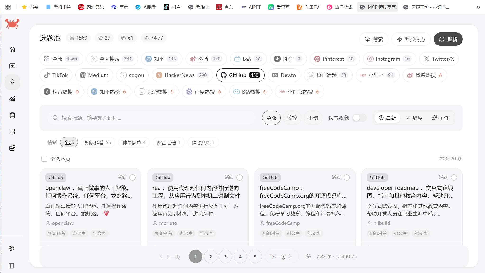
    </td>
    <td width="50%" valign="top">
      <strong>🎬 Collection & Creation</strong>

      <sub>Collect viral notes, parse their copy into cards, and preview the rendered result in real time.</sub>

      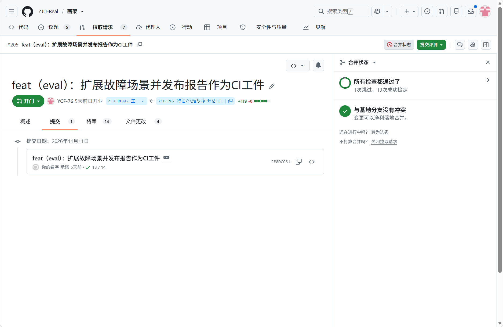
    </td>
  </tr>
  <tr>
    <td width="50%" valign="top">
      <strong>💬 Primary Conversational Agent</strong>

      <sub>Topic selection, creation, review, and publishing in one conversation, with deep-thinking traces and sub-agent execution visible end to end.</sub>

      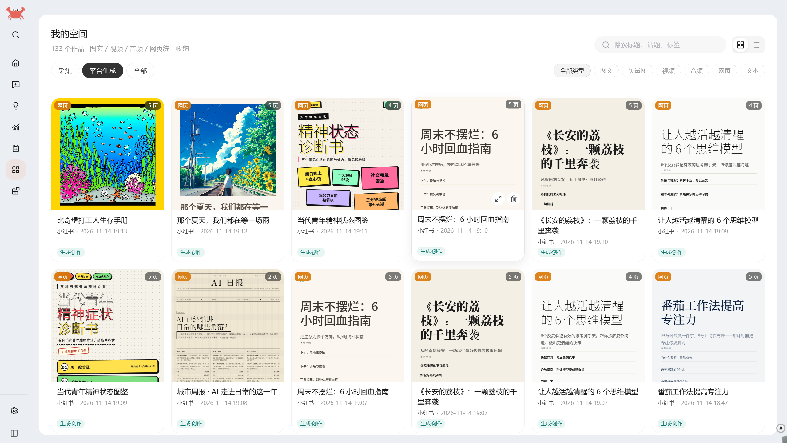
    </td>
    <td width="50%" valign="top">
      <strong>🎞️ AI Talking-Head Editing</strong>

      <sub>Smart editing for talking-head videos: overlays and effects layered on the original full-frame footage, with direct export.</sub>

      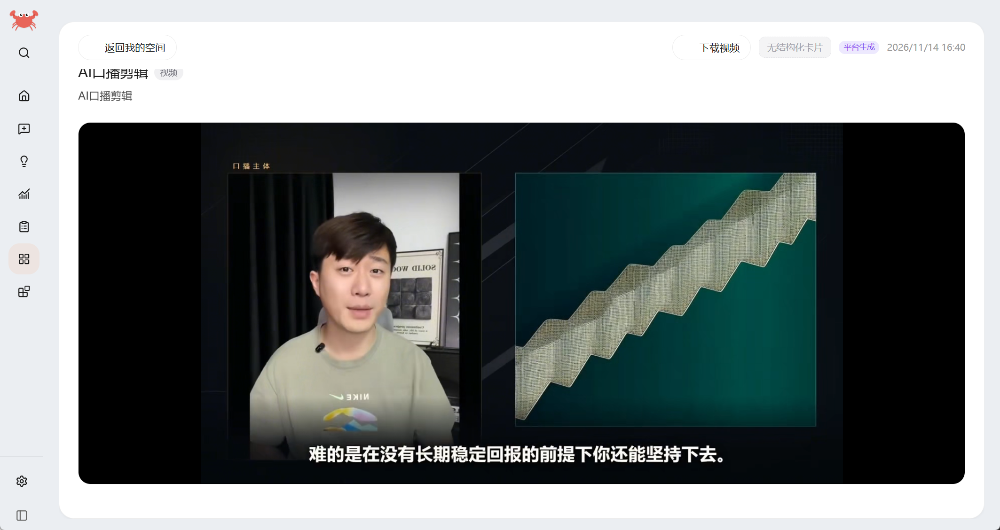
    </td>
  </tr>
  <tr>
    <td width="50%" valign="top">
      <strong>📚 My Library</strong>

      <sub>Unified management of 133+ works — photo-text, video, and audio — with one-click archiving of generated and collected content.</sub>

      
    </td>
    <td width="50%" valign="top">
      <strong>🚦 Publishing Management</strong>

      <sub>Six publishing channels, three review gates plus human confirmation — the last checkpoint before anything goes live.</sub>

      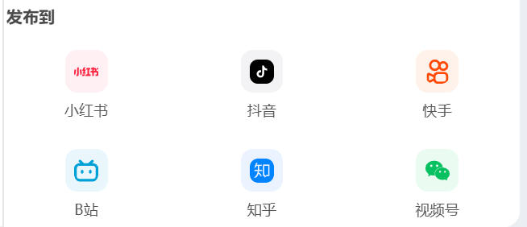
    </td>
  </tr>
</table>

> 📷 Analytics dashboard screenshot to be added.

## 🖥️ From the platform

These examples come from PulseStudio's real workflows.

<p align="center">
  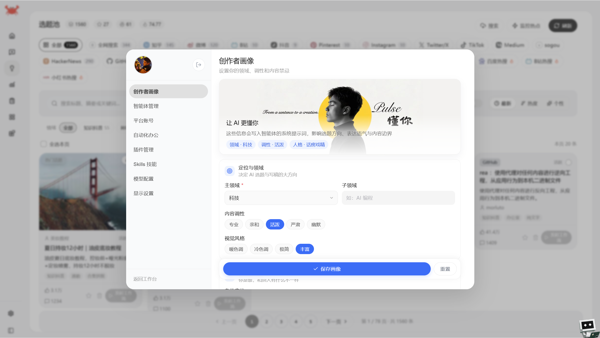
  &nbsp;
  
</p>
<p align="center">
  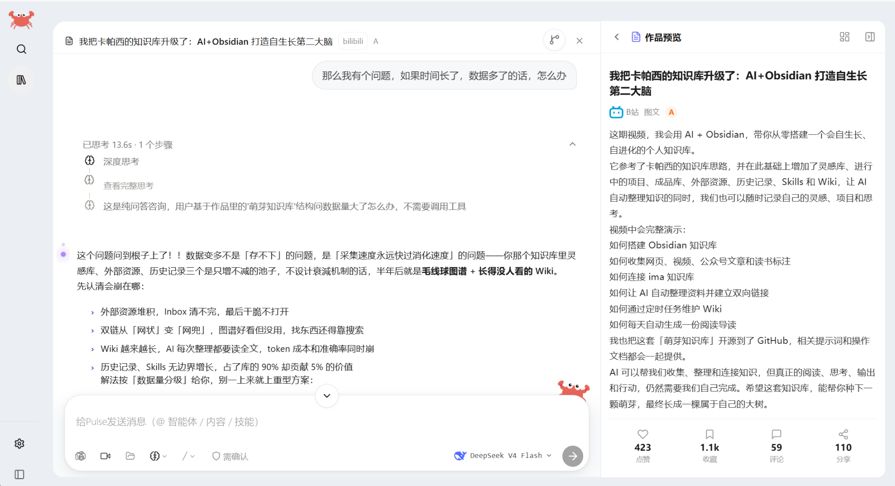
  &nbsp;
  
</p>

## 🖼️ Real outputs

<!-- ▼ Video placeholder: drag the demo video into any GitHub Issue/PR input box to upload, replace the link and uncomment:

Video (click cover to play, lightweight 1-minute preview):
<p align="center">
  <a href="user-attachments link"></a>
</p>
-->

<p align="center">
  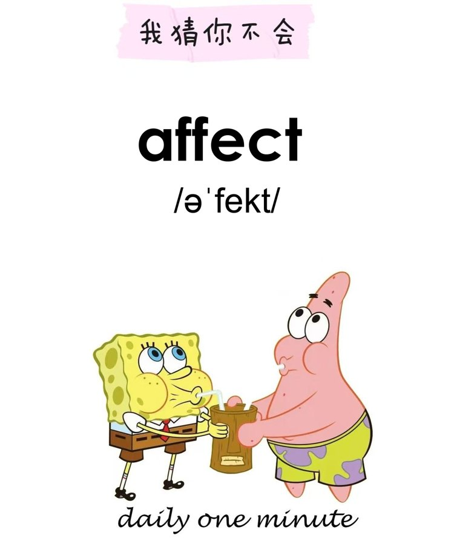
  &nbsp;
  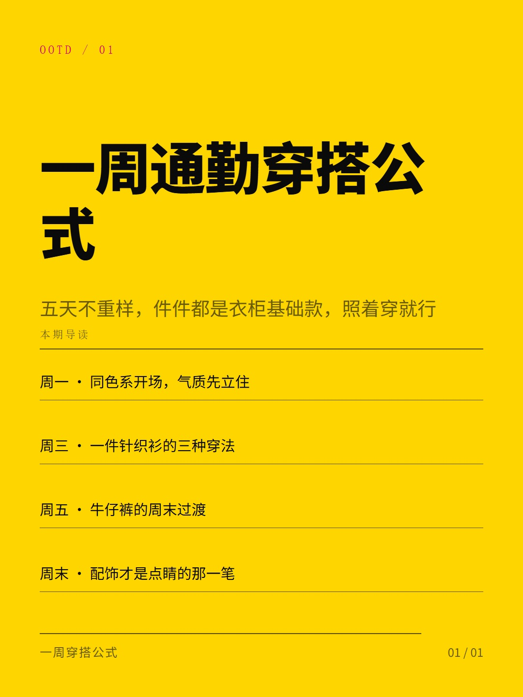
  &nbsp;
  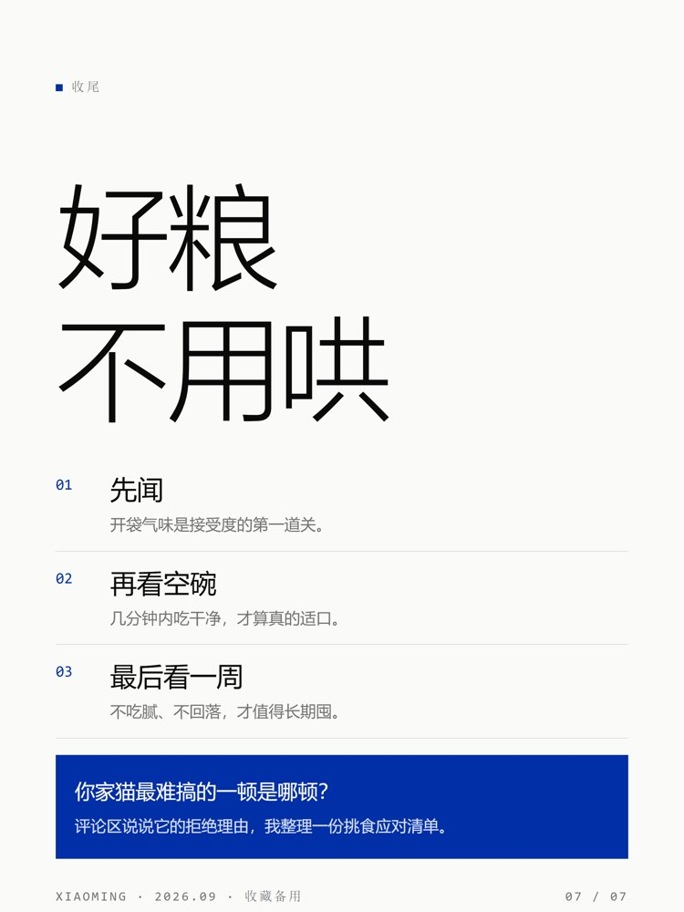
</p>
<p align="center">
  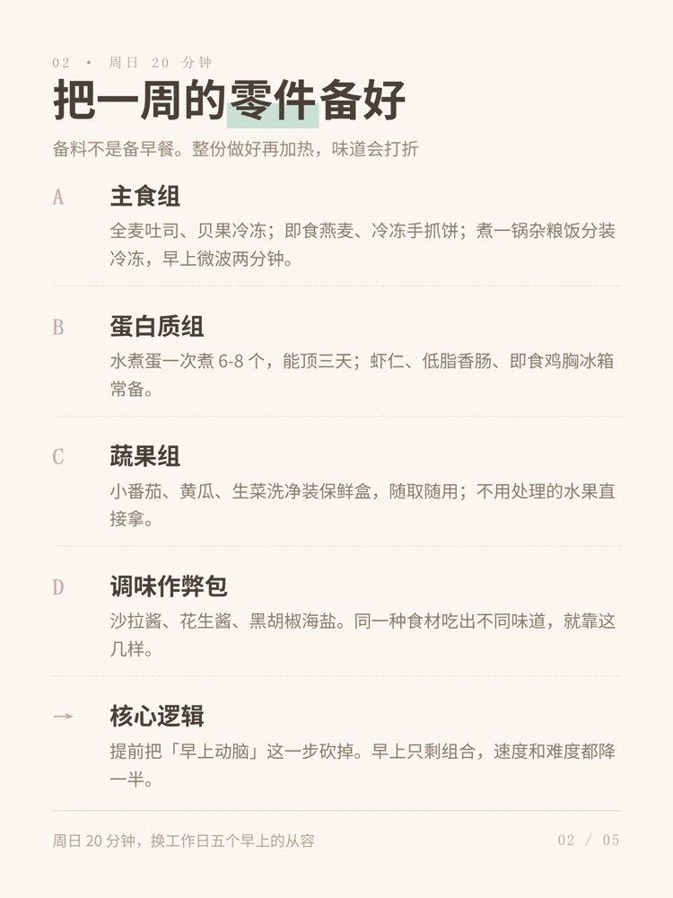
  &nbsp;
  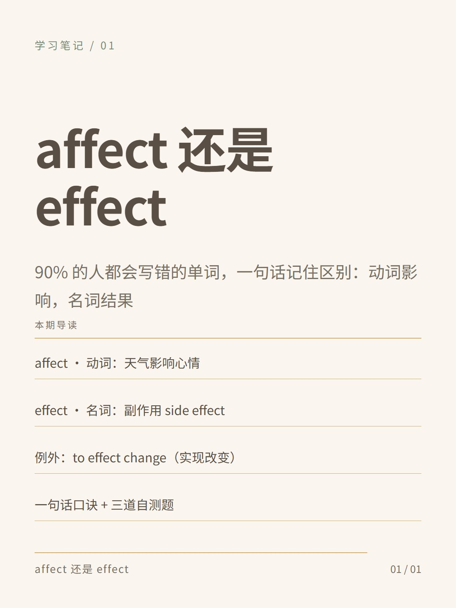
  &nbsp;
  
</p>
<p align="center"><sub>Photo-text cards · real generation output — different topics × different layouts</sub></p>

<p align="center"><sub>🎨 More generated examples: <a href="assets/showcase-local">illustration series</a> (Ghibli-style railways & sunflowers ×4 · underwater world ×2)</sub></p>

> 📷 Demo video to be uploaded (drag into a GitHub Issue, grab the link, then enable the commented block above).

## 🚀 Quick Start

Requirements: Windows 10/11, macOS, or Linux; Python 3.10+ ([uv](https://docs.astral.sh/uv/) recommended); Node.js 18+ (pnpm recommended). Defaults to SQLite with auto-migration on startup — zero configuration.

### Option 1: One-command Docker start (recommended)

```bash
git clone https://github.com/ycf-76/PulseStudio.git
cd PulseStudio

docker compose up -d          # first run builds images, afterwards it starts instantly
# Open http://localhost:8080 · API docs at http://localhost:8080/docs
# Data persists in ./docker-data/ (db / uploads / outputs)
# Model keys go in backend.environment of docker-compose.yml
```

### Option 2: Local development

```bash
git clone https://github.com/ycf-76/PulseStudio.git
cd PulseStudio

# Start the backend
cd backend
cp .env.example .env          # Windows PowerShell: Copy-Item .env.example .env
# Edit .env — at minimum set DEEPSEEK_API_KEY
pip install -e .              # or uv sync
python start_server.py        # http://localhost:8000 · API docs at /docs

# Start the frontend (new terminal)
cd frontend
pnpm install                  # or npm install
pnpm dev                      # http://localhost:5173
```

Video and speech-transcription capabilities need optional dependencies: `pip install -e ".[media]"`. For production, switch to MySQL / PostgreSQL via `DATABASE_URL`.

### Configuration reference

Full configuration in [backend/.env.example](backend/.env.example). Core entries:

| Variable | Purpose | Required |
| --- | --- | --- |
| `DEEPSEEK_API_KEY` | Default model for the primary agent and sub-agents | Required |
| `DASHSCOPE_API_KEY` | Qwen-VL visual analysis + Tongyi Wanxiang image generation | On demand |
| `XHS_MCP_PLUGIN_URL` / `XHS_MCP_LOCAL_CMD` | Xiaohongshu MCP publishing channel | On demand |
| `TAVILY_API_KEY` and other content sources | Tavily / Serper / YouTube / Brave / Reddit | On demand |
| `OPENAI_API_KEY` etc. | Multi-provider chat models (frontend switcher) | On demand |
| `LANGCHAIN_API_KEY` | LangSmith tracing | Optional |
| `REDIS_URL` | Distributed cache (falls back to in-memory) | Optional |
| `SMTP_*` | Email verification codes (dev mode prints to logs) | Optional |

## 🤖 Built-in agents

| Agent | Responsibility |
| --- | --- |
| `chat_agent` | Primary conversational entry point — the "content operations partner" that coordinates all sub-agents |
| `search` | Viral search: trends, hot topics, viral notes, and general web collection |
| `analyze` | Viral analysis: pattern insights, topic directions, competitor comparison |
| `copywrite` | Copywriting: titles, body text, hashtags |
| `image_plan` | Image planning: card visual schemes |
| `image_gen` | Image generation: AI image schemes |
| `image_review` | Image review: visual compliance checks |
| `audit` | Compliance audit: independent, unbiased content review |
| `final_review` | Final review: last gate before publishing (human confirmation gate) |
| `publish` | Publishing: platform publishing adapters |
| `explore` | Deep research: the full search → analysis → copywriting pipeline |

Plus 10 ops-team roles (persona + skill whitelist), defined in [registry.py](backend/app/agents/registry.py).

## 🏗️ Architecture

<p align="center">
  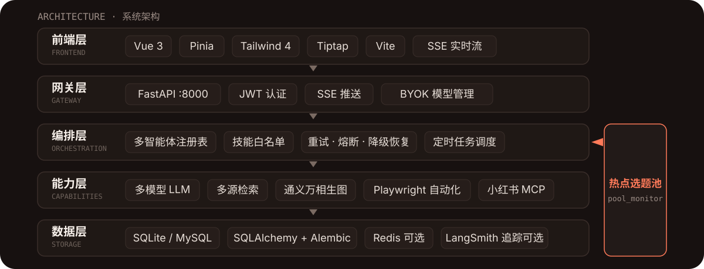
</p>

## 🗂️ Project structure

```text
├── frontend/         # Vue 3 + Vite + Pinia + Tailwind web workbench
├── backend/
│   ├── app/          # FastAPI application: agents / pool_monitor / routers & services
│   ├── capabilities/ # Capability layer (topic pool, capability services)
│   ├── skills/       # Agent-executable skills
│   ├── alembic/      # Database migrations
│   └── start_server.py
├── docs/             # Design documents (Chinese)
└── assets/readme/    # README visual assets
```

## 📖 Documentation

- [Agent team design](docs/agent-team-design.md)
- [Kernel-capability layered architecture](docs/内核-能力分层架构方案.md) (Chinese)
- [ROADMAP v2 desktop](docs/ROADMAP_v2_desktop.md) (Chinese)

## 🙌 Acknowledgements

The agent architecture and product design of PulseStudio are originally developed by this team. The Skills organization of [ZJU-REAL/Easel](https://github.com/ZJU-REAL/Easel) (Apache 2.0) served as a reference — thanks to the ZJU REAL Lab and PKU OpenDCAI Lab for their open-source work.

## 📄 License

Licensed under the [Apache License 2.0](LICENSE).
