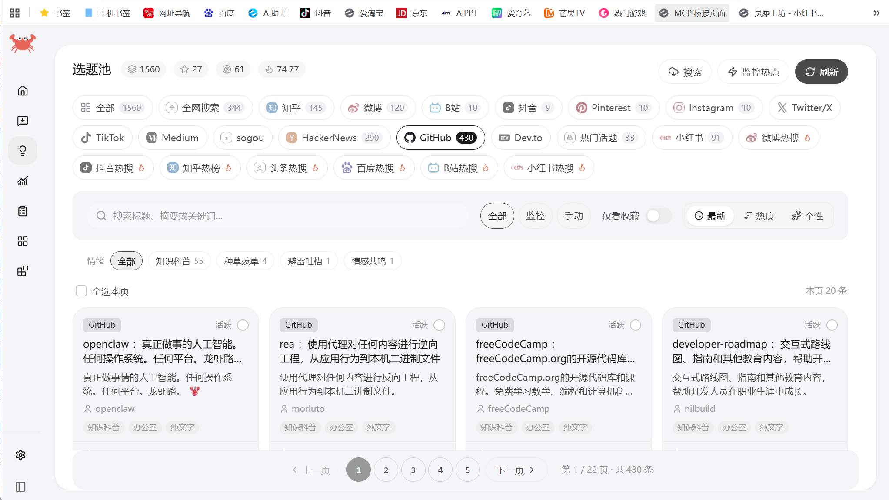
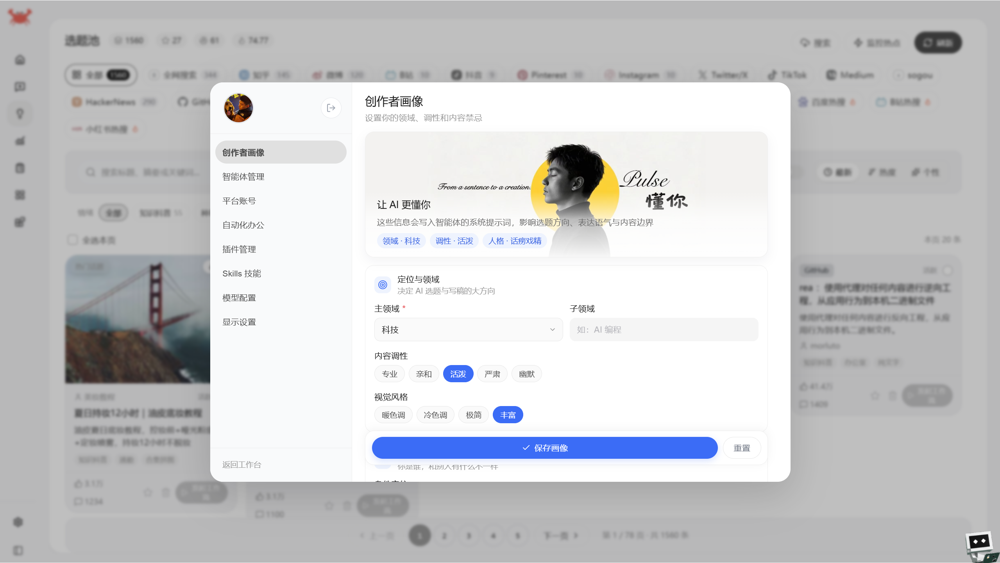
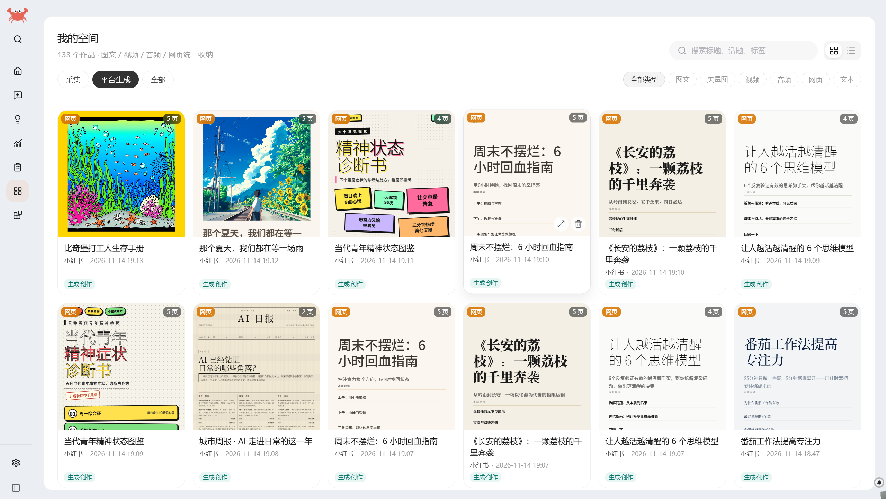
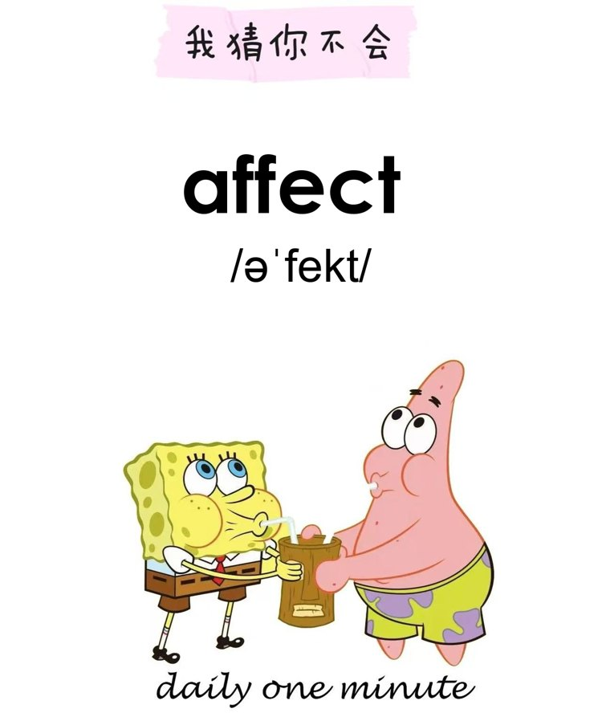
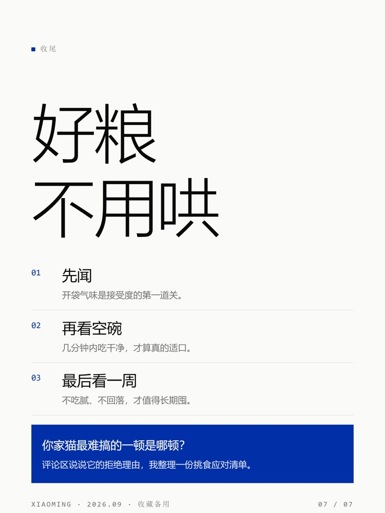
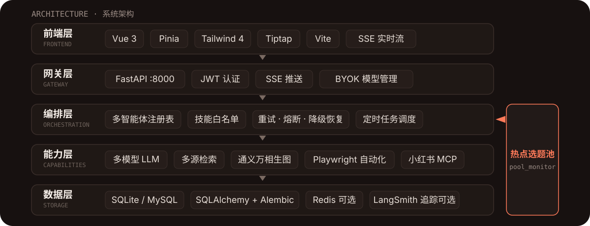

<p align="center">
  
</p>

<p align="center">
  
</p>

<p align="center">
  <a href="README.md">简体中文</a> | <a href="README.en.md">English</a>
</p>

<p align="center">
  <strong>你的 AI 内容运营搭档</strong>
</p>
<p align="center">
  从一个热点开始，完成选题、创作、审核、发布与复盘。
</p>

<p align="center">
  
  
  
  
  
  <a href="backend/app/agents/registry.py"></a>
  
  <a href="#-license"></a>
  <a href="https://github.com/ycf-76?tab=packages"></a>
  
  
  
  
  
  
  
</p>

<p align="center">
  <a href="backend/app/agents">Agent Orchestration</a> &nbsp;·&nbsp;
  <a href="backend/app/pool_monitor">Topic Pool</a> &nbsp;·&nbsp;
  <a href="backend/app/skills">Skills Library</a> &nbsp;·&nbsp;
  <a href="backend/app/sandbox">Execution Sandbox</a> &nbsp;·&nbsp;
  <a href="frontend/src">Web Workbench</a> &nbsp;·&nbsp;
  <a href="docs">Design Docs</a>
</p>

<p align="center">
  
</p>

## 🎨 PulseStudio 是什么

PulseStudio 是一个面向内容创作者的开源 AI 运营工作台。它把主对话智能体、12 个专职子智能体、热点选题池和真实的发布工具接在一起，让 Agent 不只回答「应该怎么做」，而是直接把内容做出来、审完、发出去，并把数据带回下一次创作。

你可以把它理解成一个会记住你账号的运营搭档：它知道你在追什么热点、写过什么笔记、哪类内容表现更好，从热点发现一直陪你做到发布复盘，而不是每次都从零开始。

**PulseStudio 演示视频**：

<p align="center">
  <video src="https://github.com/ycf-76/PulseStudio/releases/download/demo-v1/pulsestudio-demo.mp4" controls muted width="100%"></video>
</p>


## 📌 使用提示

> - **推荐使用 Web 前端**：前端提供会话、热点选题池、数据看板与发布管理的完整体验，也是我们推荐的使用方式；后端同时提供 REST API 与 MCP Server，可独立集成。
> - **谨慎自动发布到小红书**：平台可能检测自动化操作，存在验证、限流或账号风控风险。PulseStudio 默认在发布前设置**人工确认闸门**（`final_review`），建议保持开启，由你确认后再执行发布。
> - **模型 Key 自备（BYOK）**：一个 DeepSeek API Key 即可启动全部核心链路；其余厂商与服务按需配置，未配置的厂商会给出明确提示而不是静默失败。

## ✨ 为什么是 PulseStudio

- **一个主 Agent 贯穿完整链路**：搜热点、评选题、写文案、做配图、审合规、发平台，在同一条对话工作流中完成，不必在 5+ 个工具间来回切换。
- **选题池驱动，而不是一次性生成**：多平台热点持续监控，SimHash 去重 + LLM 价值评分，按水位管理选题库存，好选题不会被聊完就丢。
- **审核是真闸门，不是形式**：`audit`（独立无偏见视角）与 `final_review`（发布前终审）两级把关，配图另有独立合规检查，风险内容到不了发布环节。
- **一份素材，多种形态**：同一选题可以产出图文卡片、AI 配图、口播视频脚本，并按平台格式要求适配。
- **多模型 BYOK，成本可控**：DeepSeek / Qwen / OpenAI / Claude / Gemini / Moonshot / GLM 前端切换即用，默认 Key 与子 Agent 可分别指定。
- **工程化编排，失败可解释**：技能白名单控制能力边界，失败自动重试、熔断、降级、切换模型，LangSmith 全链路追踪（可选）。
- **执行有 OS 级沙箱兜底**：Windows 原生沙箱（Low 完整性令牌 + 强制完整性标签，对齐 Codex unelevated 模式）——全盘默认只读、唯一可写区为 Low 标签的 workspace，密钥文件对沙箱进程不可读，Job Object 限制资源并保证进程树整体回收。

## 🧭 内容运营全链路

1. **发现**：聚合多平台热点，SimHash 去重 + LLM 分类 + 价值评分，沉淀进热点选题池。
2. **策划**：分析爆款规律与竞品对比，把热点机会变成有切入角度的选题与内容方案。
3. **创作**：生成小红书文案（标题 / 正文 / 标签）、图文卡片配图方案与 AI 生图。
4. **审核**：`image_review` 查配图、`audit` 查内容合规、`final_review` 发布前终审，三级闸门。
5. **发布与复盘**：按平台适配并执行发布（人工确认后），回收作品数据进入看板，把有效经验沉淀回下一次选题。

## 🧰 已经落地的能力

| 能力层 | 已实现功能 |
| --- | --- |
| **发现与策划** | 多平台热点监控（Scrapling 隐身爬虫：小红书 / 抖音 / B站）、SimHash 去重、LLM 价值评分、选题水位管理、爆款搜索与采集、爆款规律分析、竞品对比、选题方向生成 |
| **文字与视觉** | 小红书文案（标题 / 正文 / 标签）、图文卡片 DSL 渲染链路、通义万相 AI 生图、Qwen-VL 配图视觉分析、配图合规检查 |
| **发布与集成** | 发布适配器与确认闸门、小红书 MCP 通道、Playwright 浏览器自动化（域名白名单）、飞书 Bot / OAuth / 多维表格、微信 iLink Bot、对外 MCP Server |
| **数据与运营** | 平台账号绑定、作品数据回收、数据看板、多日定时发布计划、用户反馈闭环 |
| **工程化底座** | 12 个内置智能体 + 10 个运营团队角色、技能白名单、重试 / 熔断 / 降级 / 模型切换、LangSmith 全链路追踪、SQLite 零配置启动（可切 MySQL / PostgreSQL）、Windows 原生执行沙箱（Low 完整性 + 完整性标签 + Job Object） |

## 🖥️ 工作台功能示例

下面是工作台中四个代表性界面，更多能力可以在技能库与文档中查看。

<table>
  <tr>
    <td width="50%" valign="top">
      <strong>🔥 热点选题池</strong>

      <sub>多平台热点聚合、去重与价值评分，按水位管理选题库存，支持 REST API 手动干预。</sub>

      
    </td>
    <td width="50%" valign="top">
      <strong>🎬 采集与创作</strong>

      <sub>爆款笔记采集入库，卡片化解析原文案，手机端实时预览成图效果。</sub>

      
    </td>
  </tr>
  <tr>
    <td width="50%" valign="top">
      <strong>💬 主对话智能体</strong>

      <sub>一条对话完成选题、创作、审核与发布，深度思考过程与子 Agent 执行透明可见。</sub>

      
    </td>
    <td width="50%" valign="top">
      <strong>🎞️ AI 口播剪辑</strong>

      <sub>口播视频智能剪辑，在原片全屏基础上叠加素材与特效，成片可直接导出。</sub>

      
    </td>
  </tr>
  <tr>
    <td width="50%" valign="top">
      <strong>📚 我的空间</strong>

      <sub>133 个作品统一管理，图文 / 视频 / 音频分类检索，平台生成与采集一键归档。</sub>

      
    </td>
    <td width="50%" valign="top">
      <strong>🚦 发布管理</strong>

      <sub>六大平台发布通道，三级审核闸门 + 人工确认，发布前最后一道关。</sub>

      
    </td>
  </tr>
</table>

> 📷 数据看板的界面截图待补充。

## 🖥️ 平台实况

这些示例来自 PulseStudio 的实际工作流。

<p align="center">
  
  &nbsp;
  
</p>
<p align="center">
  
  &nbsp;
  
</p>

## 🖼️ 真实产物

<!-- ▼ 视频占位：把演示视频拖进任意 GitHub Issue/PR 的输入框上传，得到 user-images.githubusercontent.com 链接后替换并取消注释：

视频（封面点击播放，最长 1 分钟轻量预览）：
<p align="center">
  <a href="user-attachments 链接"></a>
</p>
-->

<p align="center">
  
  &nbsp;
  
  &nbsp;
  
</p>
<p align="center">
  
  &nbsp;
  
  &nbsp;
  
</p>
<p align="center"><sub>图文卡片 · 实际生成效果，不同主题 × 不同版式</sub></p>

<p align="center"><sub>🎨 更多生成案例：<a href="assets/showcase-local">插画系列</a>（吉卜力风铁道与向日葵 ×4 · 海底世界 ×2）</sub></p>

> 📷 演示视频待上传（拖进 GitHub Issue 取链接后按上方注释启用）。

## 🚀 快速开始

环境要求：Windows 10/11、macOS 或 Linux，Python 3.10+（推荐 [uv](https://docs.astral.sh/uv/)），Node.js 18+（推荐 pnpm）。默认 SQLite，启动自动建表，零配置运行。

### 方式一：Docker 一键启动（推荐）

```bash
git clone https://github.com/ycf-76/PulseStudio.git
cd PulseStudio

docker compose up -d          # 首次会构建镜像，之后秒起
# 打开 http://localhost:8080 · API 文档 http://localhost:8080/docs
# 数据持久化在 ./docker-data/（db / uploads / outputs）
# 模型 Key 在 docker-compose.yml 的 backend.environment 里配置
```

### 方式二：本地开发

```bash
git clone https://github.com/ycf-76/PulseStudio.git
cd PulseStudio

# 启动后端
cd backend
cp .env.example .env          # Windows PowerShell: Copy-Item .env.example .env
# 编辑 .env，至少填写 DEEPSEEK_API_KEY
pip install -e .              # 或 uv sync
python start_server.py        # http://localhost:8000 · API 文档 /docs

# 启动前端（新开终端）
cd frontend
pnpm install                  # 或 npm install
pnpm dev                      # http://localhost:5173
```

视频与语音转写等能力需要额外安装可选依赖：`pip install -e ".[media]"`；生产环境可通过 `DATABASE_URL` 切换 MySQL / PostgreSQL。

### 配置速查

完整配置见 [backend/.env.example](backend/.env.example)，核心项：

| 变量 | 说明 | 必需性 |
| --- | --- | --- |
| `DEEPSEEK_API_KEY` | 主对话与子 Agent 默认模型 | 必填 |
| `DASHSCOPE_API_KEY` | Qwen-VL 视觉分析 + 通义万相生图 | 按需 |
| `XHS_MCP_PLUGIN_URL` / `XHS_MCP_LOCAL_CMD` | 小红书 MCP 发布通道 | 按需 |
| `TAVILY_API_KEY` 等内容源 Key | Tavily / Serper / YouTube / Brave / Reddit | 按需 |
| `OPENAI_API_KEY` 等 | 多厂商对话模型（前端切换器） | 按需 |
| `LANGCHAIN_API_KEY` | LangSmith 运行追踪 | 可选 |
| `REDIS_URL` | 分布式缓存（缺省降级为内存缓存） | 可选 |
| `SMTP_*` | 邮箱验证码（缺省开发模式打印到日志） | 可选 |

## 🤖 内置智能体

| Agent | 职责 |
| --- | --- |
| `chat_agent` | 主对话入口「内容运营搭档」，协调所有子 Agent |
| `search` | 爆款搜索：热点、趋势、爆款笔记与任意网页采集 |
| `analyze` | 爆款分析：规律洞察、选题方向、竞品对比 |
| `copywrite` | 文案创作：标题、正文、标签 |
| `image_plan` | 图片规划：卡片配图方案 |
| `image_gen` | 图片生成：AI 生图方案 |
| `image_review` | 图片审核：配图合规检查 |
| `audit` | 合规审核：独立无偏见的内容审核视角 |
| `final_review` | 终审确认：发布前最终把关（人工确认闸门） |
| `publish` | 发布：对接平台发布适配器 |
| `explore` | 探索研究：搜索 + 分析 + 文案的全链路深度研究 |

另有 10 个运营团队角色（persona + 技能白名单），定义见 [registry.py](backend/app/agents/registry.py)。

## 🏗️ 系统架构

<p align="center">
  
</p>

## 🗂️ 目录结构

```text
├── frontend/         # Vue 3 + Vite + Pinia + Tailwind 前端工作台
├── backend/
│   ├── app/          # FastAPI 应用：agents / pool_monitor / 路由与服务
│   ├── capabilities/ # 能力层（热点池、能力服务等）
│   ├── skills/       # 智能体可执行技能
│   ├── alembic/      # 数据库迁移
│   └── start_server.py
├── docs/             # 设计文档与方案
└── assets/readme/    # README 视觉资产
```

## 📖 文档

- [智能体团队设计](docs/agent-team-design.md)
- [内核能力分层架构方案](docs/内核-能力分层架构方案.md)
- [ROADMAP v2 桌面端](docs/ROADMAP_v2_desktop.md)

## 🙌 致谢

项目的智能体架构与产品设计均为自主研发。[ZJU-REAL/Easel](https://github.com/ZJU-REAL/Easel)（Apache 2.0）的 Skills 组织方式为我们提供了参考，在此感谢浙大 REAL Lab 与北大 OpenDCAI Lab 的开源工作。

## 📄 License

本项目基于 [Apache License 2.0](LICENSE) 协议开源。
