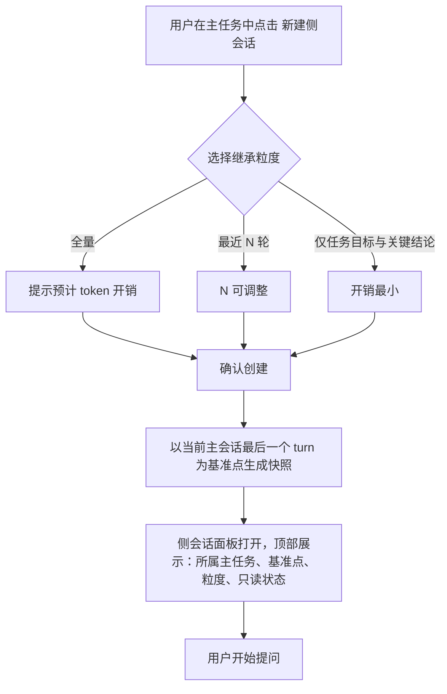
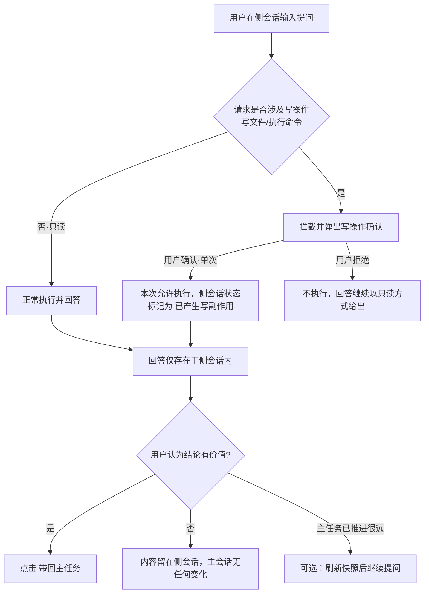
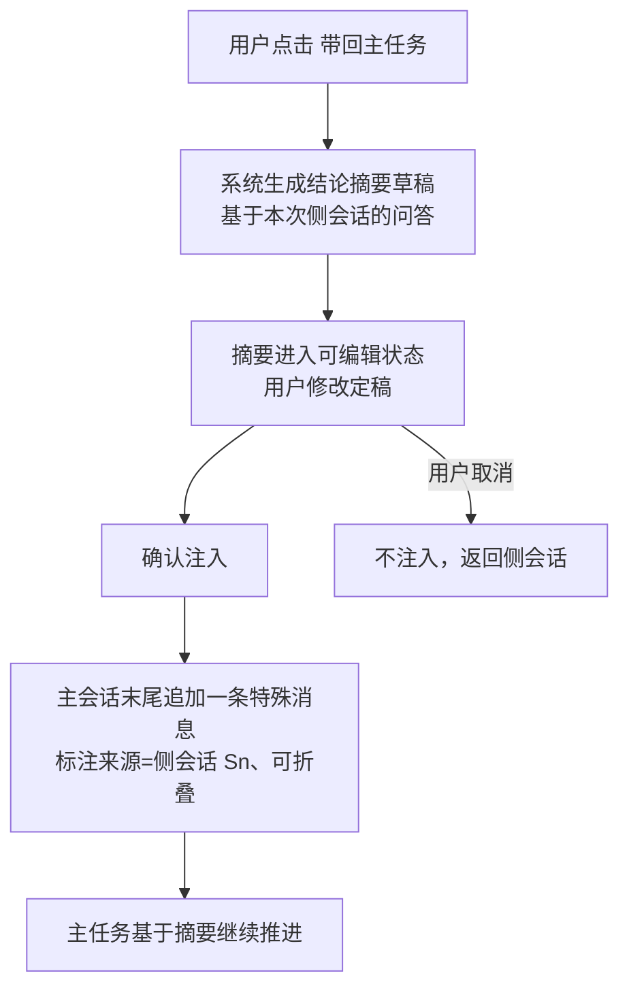
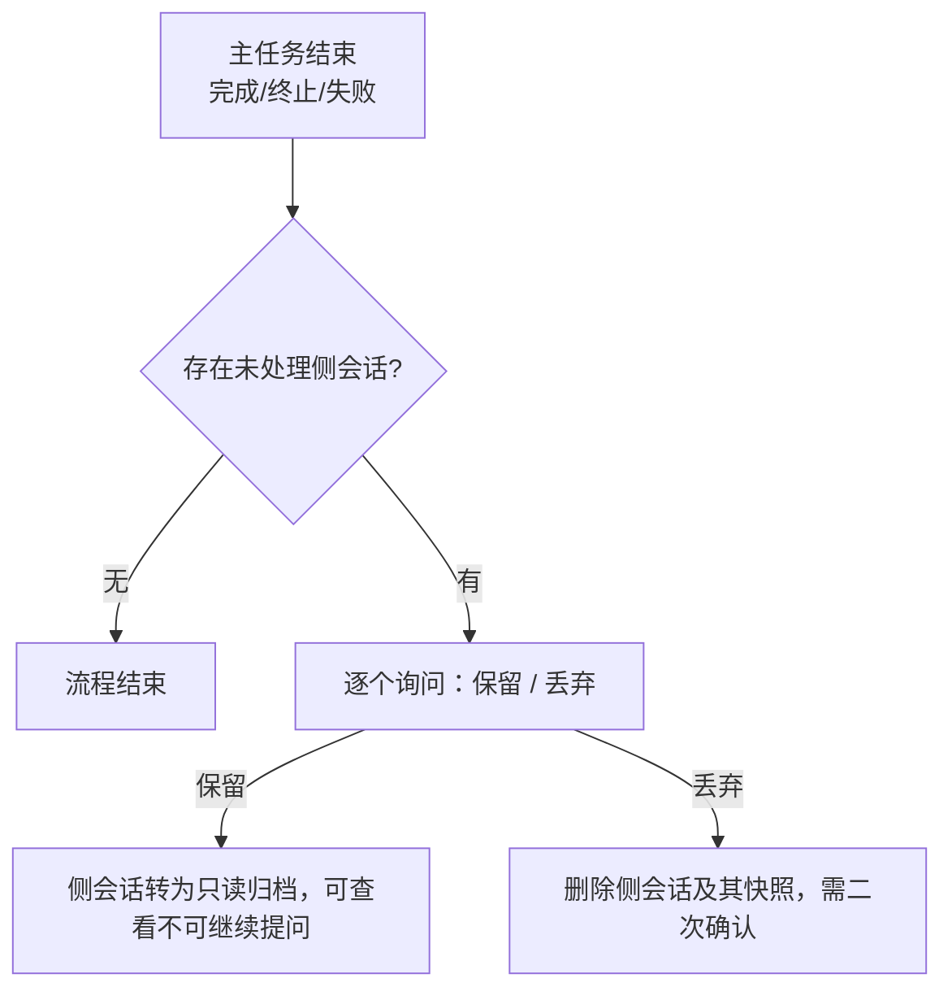

# PRD：主任务 + 侧会话（Side Session）——长程任务中的探索性问答隔离机制

| 项 | 内容 |
|---|---|
| 文档状态 | 已确认（开放问题按建议方案冻结，Q4 除外，见 §12） |
| 版本 | v0.3 |
| 日期 | 2026-11-03 |
| 作者 | [TBD] |
| 评审人 | [TBD] |

> 标注约定：`[Assumption, TBD]` 表示推导出的假设条件，需评审确认；`[TBD]` 表示缺失信息，需产品决策。未标注的结论均来自需求梳理阶段已确认的设计要点。

---

## 1. 背景与问题定义

### 1.1 背景

产品正在支持长程任务执行场景：主会话（Main Session）承载一个持续时间长、步骤间强依赖的任务，主对话的上下文窗口是任务推理的核心资产。

在任务执行过程中，用户会自然产生"探索性提问"——例如对某个功能不了解、需要查资料、需要小范围试错验证。这类提问的典型特征是：**对当前任务步骤有辅助价值，但不推进任务本身，且内容量大、发散度高。**

### 1.2 问题

探索性问答与主任务共享同一个对话通道时，产生三类可观察的负面后果：

1. **窗口占用**：问答原文（含资料粘贴、试错输出）进入主对话，挤占长程任务本就紧张的上下文预算。
2. **注意力稀释**：主对话的推理链被无关内容打断，模型对任务目标的聚焦被稀释。
3. **任务带偏**：探索过程中发现的新线索可能诱导主对话偏离原任务走向。

用户当前可选的规避方式均不成立：

| 现有规避方式 | 失败原因 |
|---|---|
| 直接在主对话中提问 | 占用窗口、稀释注意力、可能带偏任务 |
| 压抑提问、继续执行 | 用户卡住，任务停滞或带错误假设推进 |
| 另开全新会话提问 | 新会话无任务上下文，用户需手工重述背景，成本高且易失真 |

### 1.3 产品响应

在主任务之下提供**侧会话（Side Session）**机制：

- **读方向（主 → 侧）**：侧会话可读取主任务上下文，默认开启，继承粒度可选——解决"新会话没有任务背景"的问题。
- **写方向（侧 → 主）**：侧会话中的问答默认不进入主任务，回写由用户显式触发，且为**提炼式回写**——解决"污染主窗口"的问题。
- **控制权**：是否带回、带回什么，由用户按需决定，落地为"按需传入、非必要不传"。

**预期可观察结果**（定性）：用户可以在不打断、不污染主任务上下文的前提下，随时发起探索性问答，并在认为有价值时以摘要形式将结论带回主任务。

---

## 2. 目标与非目标

### 2.1 目标

| # | 目标（可观察表述） |
|---|---|
| G1 | 用户在主任务执行中可一键创建侧会话，且侧会话自动携带所选粒度的任务上下文，无需手工重述背景 |
| G2 | 侧会话内的全部问答默认不出现在主会话中，主对话流不因探索性问答增加任何内容 |
| G3 | 用户可将侧会话结论以**可编辑的摘要**形式带回主任务，带回内容是一条独立、可识别的特殊消息，而非对话原文搬运 |
| G4 | 用户能随时、无歧义地分辨当前交互发生在主会话还是侧会话 |
| G5 | 侧会话支持并行开启多个，且与主任务生命周期绑定，主任务结束时可选择保留或丢弃 |
| G6 | 侧会话默认只读（不产生对工作区/环境的写副作用），写操作需用户单独确认 |

### 2.2 非目标（本期明确不做）

| # | 非目标 | 说明 |
|---|---|---|
| N1 | **不提供主任务与侧会话之间的实时上下文共享** | 明确采用创建时快照而非实时同步，避免侧会话基准漂移（见 §7.1 FR-A2） |
| N2 | **不做环境级隔离（沙箱/容器/独立工作区）** | 上下文隔离 ≠ 环境隔离；本期通过"默认只读 + 写确认"约束副作用，不引入隔离运行环境 |
| N3 | **不做自动回写/自动摘要注入** | 回写必须由用户显式触发，不做"系统判断有价值自动带回" |
| N4 | **不做多侧会话内容自动去重或互相同步** | 多个侧会话之间的重复劳动问题本期仅通过可见性设计缓解（见 §9.2 风险 RK2），不做自动机制 |
| N5 | **不做侧会话独立计费或配额体系** | 成本控制仅体现在继承粒度选择与提示（§7.6） |
| N6 | **不做侧会话跨主任务复用** | 侧会话从属于唯一主任务，不支持挂到另一个主任务下 |

---

## 3. 名词与概念定义

| 术语 | 定义 |
|---|---|
| **主任务（Main Task）** | 用户发起的长程任务，对应主会话。是侧会话的宿主与上下文来源 |
| **主会话（Main Session）** | 承载主任务的主对话流，其上下文窗口是需要被保护的资源 |
| **侧会话（Side Session）** | 挂靠在某主任务之下的附属会话，用于探索性问答。从属于唯一主任务，可并行多个 |
| **探索性提问（Exploratory Question）** | 用户在任务执行中产生的、以理解/查证/试错为目的、不直接推进任务进度的提问 |
| **上下文快照（Context Snapshot）** | 创建侧会话时，按所选继承粒度对主会话在某个基准 turn 的上下文复制。创建后不再随主会话推进而更新 |
| **基准点（Baseline Turn）** | 快照所对应的主会话消息轮次，是判断快照新旧与是否刷新的依据 |
| **继承粒度（Inheritance Granularity）** | 快照的内容范围，三档：全量 / 最近 N 轮 / 仅任务目标与关键结论 |
| **刷新快照（Snapshot Refresh）** | 用户显式操作：以当前主会话状态为基准点重建侧会话的继承上下文 |
| **带回主任务（Bring Back）** | 用户显式触发的回写操作：将侧会话中可编辑的结论摘要作为一条特殊消息注入主会话 |
| **提炼式回写（Distilled Write-back）** | 回写的唯一合法形式：只传摘要，不传对话原文。摘要在回写前可编辑 |
| **特殊消息（Special Message）** | 主会话中标识为"来自侧会话"的消息类型，有独立视觉样式与来源标注，参与主任务上下文但不可被普通追问自动展开为完整侧会话内容 |
| **只读模式（Read-only Mode）** | 侧会话的默认权限状态：允许读取、检索、分析，禁止一切写文件/执行命令类副作用操作 |

---

## 4. 用户角色与用户故事

### 4.1 角色

本功能面向单一产品角色：**执行长程任务的用户**（主任务发起人与侧会话所有者为同一人）。多角色协作场景不在本期范围（§12 Q10 已确认，远期评估）。

### 4.2 用户故事

| # | 用户故事 | 对应目标 |
|---|---|---|
| US1 | 作为长程任务的执行者，当我遇到不了解的功能想查清楚时，我希望**在不离开任务、不污染主对话**的情况下提问，以免主上下文被稀释 | G1、G2 |
| US2 | 作为任务执行者，我希望侧会话**自动带上任务背景**（目标、已做过的关键决策），这样我不需要重新解释我在做什么 | G1 |
| US3 | 作为任务执行者，当任务已推进很远、侧会话的旧快照不再贴合现状时，我希望**刷新快照**或重新选择继承粒度，以免得到过时的答案 | G1 |
| US4 | 作为任务执行者，当侧会话里得出了有价值的结论（如某个参数应改为 X），我希望**编辑一段摘要并一键带回主任务**，让主任务基于结论继续，而不是基于我提问的过程 | G3 |
| US5 | 作为任务执行者，我想**同时开多个侧会话**分别探索不同方向（如一个查文档、一个试方案），且每个都继承任务背景 | G5 |
| US6 | 作为任务执行者，当主任务完成或终止时，我希望**自己决定**侧会话是保留备查还是随任务丢弃 | G5 |
| US7 | 作为任务执行者，我希望侧会话**默认不会改我的文件、不会执行有副作用的命令**；当它确实需要写操作时，我要能逐次确认 | G6 |
| US8 | 作为关注成本的用户，我希望继承上下文的 token 开销**可见且可控**——我能选择只带"任务目标与关键结论"而非全部历史 | G1、成本控制 |
| US9 | 作为用户，无论我在主会话还是某个侧会话中输入，我希望**界面上一眼可辨**当前在哪个窗口，避免把探索性内容误发进主任务 | G4 |

---

## 5. 产品模型概览

```text
主任务（Main Task）
 │
 ├── 主会话（Main Session）←—— 特殊消息（来自侧会话的摘要回写）
 │
 ├── 侧会话 S1（快照@turn12，粒度=最近N轮，只读）
 ├── 侧会话 S2（快照@turn15，粒度=全量，只读）
 └── 侧会话 S3（快照@turn15，粒度=仅目标与结论，只读）

读方向：快照（一次性复制，基准点=创建时/刷新时的某个 turn）
写方向：仅"带回主任务"一条通道，且只允许提炼式摘要
环境：主、侧共享同一工作区与文件系统（见 §7.4 权限边界）
```

概念关系要点（均为已确认设计决策）：

1. 侧会话与主任务**生命周期绑定**；主任务是父对象，侧会话是子对象。
2. 继承是**创建时快照**，不是实时共享；快照有明确基准点。
3. 回写是**唯一写通道**，且只允许提炼式摘要。

---

## 6. 核心交互流程

### 6.1 创建侧会话



规则：

- 创建入口只在主任务上下文中提供（主会话工具栏）；侧会话不可再建侧会话。
- 快照基准点 = 创建动作发生时主会话的最新已完成 turn，且在侧会话内**始终可见**（如"基于主任务第 12 轮"）。
- 全量继承在主会话上下文超过阈值时必须给出开销提示 `[v0.3 冻结：快照体积超过 32k tokens 提示，阈值可配置]`。
- 主任务正在执行（流式输出中）时创建：快照基准点取最后一个已完成 turn，进行中内容不计入快照（FR-A8）。

### 6.2 在侧会话中提问



规则：

- 侧会话回答默认**不进入主会话**（写方向默认关闭），主会话无任何感知。
- 写操作确认是**逐次确认**，不提供"本次会话内一律放行"的长期授权（§12 Q9 已确认维持逐次确认）。
- 快照过期（主任务基准点之后推进了多个 turn）时，侧会话内应出现"快照已过期"提示与刷新入口（见 §7.1 FR-A4）。

### 6.3 选择性带回主任务



规则（提炼式回写，已确认）：

- 回写内容是**摘要而非对话原文**；系统生成草稿，用户**必须可编辑**。
- 注入主会话后是一条**特殊消息**：带"来自侧会话"来源标识、独立视觉样式、可折叠；默认展开（§12 Q8 已确认）。
- 一次带回对应一条特殊消息；同一侧会话可多次带回，每次生成新的摘要草稿。
- 带回后侧会话不关闭、不改变状态，可继续使用。
- 主任务正在执行时带回：特殊消息排队至当前 turn 结束后注入，不打断执行（FR-B8）。

### 6.4 主任务结束



---

## 7. 功能需求

> 分组：A 上下文继承（读方向）/ B 隔离与回写（写方向）/ C 生命周期 / D 权限与只读 / E 可见性与交互 / F 成本控制。
> 优先级定义：P0 = MVP 必备，缺失则核心旅程不成立；P1 = 显著提升体验，首迭代后尽快补齐；P2 = 远期增强。

### 7.1 A 组：上下文继承（读方向）

| ID | 需求 | 优先级 |
|---|---|---|
| FR-A1 | 侧会话创建时按所选粒度生成主会话上下文快照，作为侧会话的背景知识 | P0 |
| FR-A2 | 继承方式为**创建时快照**而非实时共享；主会话后续推进不改变已创建侧会话的快照 | P0 |
| FR-A3 | 继承粒度三档可选：**全量 / 最近 N 轮 / 仅任务目标与关键结论**，创建时必选其一，默认值见 §8 共享规则 R1 | P0 |
| FR-A4 | **快照过期提示**：当主会话在基准点之后新增 turn 数超过阈值时，侧会话界面显示"快照已过期，主任务已推进 X 轮"，并提供「刷新快照」入口 `[v0.3 冻结：新增 ≥5 轮提示，可配置]` | P0 |
| FR-A5 | **刷新快照**：用户显式触发，以刷新时刻主会话最新 turn 为新基准点重建继承上下文；刷新前给出将替换现有快照的确认；刷新不清空侧会话内已产生的问答记录 | P1 |
| FR-A6 | 基准点在侧会话内持久可见（如头部标注"基于主任务第 N 轮 · [粒度]"） | P0 |
| FR-A7 | 仅目标与关键结论档位的内容构成：任务原始目标 + 主会话中的关键阶段性结论；"关键结论"的判定规则为产品侧约定（见 §8 R2），不由模型自由发挥 | P0 |
| FR-A8 | **执行中创建的时序约束**：主任务正在执行（模型流式输出中）时创建侧会话，快照基准点取最后一个**已完成** turn；进行中未完成的内容不计入快照 | P0 |

### 7.2 B 组：隔离与回写（写方向）

| ID | 需求 | 优先级 |
|---|---|---|
| FR-B1 | 侧会话内的**全部**问答内容默认不进入主会话，主会话上下文不因侧会话活动增加任何内容 | P0 |
| FR-B2 | 回写仅通过「带回主任务」显式触发；不存在自动回写、定时回写或"确认后批量回写" | P0 |
| FR-B3 | 「带回主任务」采用**提炼式回写**：系统基于侧会话问答生成结论摘要草稿 → 用户可编辑 → 确认后注入；**禁止整段对话搬运**，回写内容中不得包含侧会话完整问答原文 | P0 |
| FR-B4 | 回写注入主会话的是一条**特殊消息**：带侧会话来源标识（如"来自侧会话 S2"）、独立视觉样式、可折叠；特殊消息参与主任务后续上下文；长度受硬约束（≤ 对应问答原文 token 数的 30%，超限时禁止注入并提示用户精简） | P0 |
| FR-B5 | 同一侧会话支持多次带回，每次独立生成摘要草稿；带回操作可随时取消（确认前） | P0 |
| FR-B6 | 摘要草稿生成：由侧会话所在模型基于本次侧会话问答生成，**仅使用侧会话上下文**，不读取、不消耗主会话上下文；以最近一次问答以来的结论为主要素材；用户编辑后的定稿以用户版本为准注入 | P1 |
| FR-B7 | 侧会话之间不共享内容、不自动同步；用户在侧会话列表中可看到其他并行侧会话的标题与状态，以减少重复探索（缓解手段，不做自动去重） | P2 |
| FR-B8 | **执行中带回的时序约束**：主任务正在执行时执行「带回主任务」，特殊消息排队至当前 turn 结束后注入主会话，不打断进行中的执行；注入完成后在主会话可见 | P0 |

### 7.3 C 组：生命周期

| ID | 需求 | 优先级 |
|---|---|---|
| FR-C1 | 侧会话从属于唯一主任务，不可转移、不可跨任务复用 | P0 |
| FR-C2 | 支持**并行开启多个**侧会话，数量上限 5（v0.3 冻结，可配置），达到上限时给出行内提示 | P0 |
| FR-C3 | 主任务结束后，对每个仍活跃的侧会话询问**保留或丢弃**；保留 → 只读归档（可查看、不可继续提问与带回）；丢弃 → 删除侧会话与快照，需二次确认 | P0 |
| FR-C4 | 主任务被强制终止/异常中断时，侧会话按默认策略处理（v0.3 冻结：默认保留归档，避免误删，用户可事后手动删除） | P1 |
| FR-C5 | 归档侧会话在主任务详情中可再次打开查看；不可"复活"为活跃会话，如需继续探索须新建侧会话（新快照） | P2 |
| FR-C6 | 删除侧会话不产生对主任务上下文的任何变更（已带回的特殊消息保留） | P0 |

### 7.4 D 组：权限与只读边界

> 前提（已确认）：**上下文隔离 ≠ 环境隔离**。主、侧会话共享同一工作区与文件系统，侧会话的写副作用会真实影响主任务环境，因此以"默认只读 + 写确认"为边界。

| ID | 需求 | 优先级 |
|---|---|---|
| FR-D1 | 侧会话**默认只读**：允许读取文件、检索、分析、回答；禁止写文件、删除文件、执行有副作用的命令 | P0 |
| FR-D2 | 侧会话请求写操作时**拦截并逐次确认**：弹窗列明将执行的具体动作与影响对象；确认仅对当次生效 | P0 |
| FR-D3 | 侧会话发生过写副作用后，在侧会话头部与主任务侧会话列表中**持久标记**"已产生写副作用"，避免用户误以为探索无痕 | P0 |
| FR-D4 | 主任务结束后**保留归档**的侧会话一律只读，不再接受任何写操作 | P0 |
| FR-D5 | 拒绝写确认时，侧会话继续以只读方式尽可能回答（如给出"若允许写入我将执行…"的说明），而非中断会话 | P1 |
| FR-D6 | 写操作确认交互需明示"此操作将影响主任务共享的工作区环境" | P0 |

### 7.5 E 组：可见性与交互

| ID | 需求 | 优先级 |
|---|---|---|
| FR-E1 | 主会话与侧会话在**视觉上明确区分**（布局/色彩/标识至少其一），且当前所在窗口身份始终可辨 | P0 |
| FR-E2 | 侧会话面板持续展示：所属主任务、快照基准点、继承粒度、只读状态、写副作用标记 | P0 |
| FR-E3 | 主会话内可查看侧会话列表（标题、状态、快照基准点）；侧会话标题支持自动生成与手动改名 | P1 |
| FR-E4 | 特殊消息（带回内容）在主会话中有独立样式与来源标注，与普通用户消息不可混淆 | P0 |
| FR-E5 | 快照过期提示出现在侧会话内显著位置（与 FR-A4 联动） | P0 |
| FR-E6 | 主会话与侧会话间的切换操作在一步以内可达（如点击列表项/标签），切换不丢失任一会话的输入草稿 | P1 |

### 7.6 F 组：成本控制

| ID | 需求 | 优先级 |
|---|---|---|
| FR-F1 | 「非必要不传入」落地为**继承粒度选择**（FR-A3）：默认档位为开销最小档之外的合理平衡档（默认值见 §8 R1） | P0 |
| FR-F2 | 选择全量继承或快照体积超过阈值时，创建确认处**明示预计 token 开销**（v0.3 冻结：相对量级——高/中/低，相对主会话当前上下文体积） | P1 |
| FR-F3 | 刷新快照同样受粒度选择约束，并复用 FR-F2 的开销提示 | P1 |
| FR-F4 | 侧会话的 token 消耗在会话内可见（累计量级即可），帮助用户决定保留/丢弃 `[P2]` | P2 |

---

## 8. 共享规则（跨组统一定义）

**R1 继承粒度默认值**（v0.3 冻结，§12 Q1）：默认「最近 N 轮」，N=10，创建时可调（5–50）。理由：实现风险小，不依赖「关键结论」判定细则（R2）的落地进度；仍遵循"非必要不传入"原则，需要更多背景的用户可主动升档。

**R2 「关键结论」构成**：指主会话中满足以下之一的轮次内容——任务目标的原始陈述、用户做出的方向性决策（含否决）、关键验收口径。提取规则为产品约定并固定，不依赖模型现场判断 `[判定细则待冻结——v0.3 起不阻塞 MVP（默认档位为「最近 N 轮」）；实现「仅目标与关键结论」档前须冻结，见 §12 Q4。初版思路：以规则识别为主（目标陈述 turn、含决策语义的用户 turn、验收口径 turn）+ 用户手动标记兜底]`。

**R3 快照不可变性**：快照一经创建（或刷新）即不可变；侧会话内新产生的问答**不属于**快照，不会回灌主会话，也不影响下一次刷新的基准点选择。

**R4 带回是唯一跨会话内容通道**：任何侧会话内容进入主会话的唯一途径是 FR-B3 的提炼式回写；除此之外读方向只在创建/刷新时发生一次。

**R5 只读判定**（v0.3 冻结初版清单，§12 Q5；工程实现时逐项复核扩充）：只读约束作用于**副作用类工具调用**。初版清单——

- **计为写副作用**：创建/修改/删除/移动/重命名文件、执行 shell 命令、包管理安装卸载、网络写请求（POST/PUT/PATCH/DELETE）、git 写操作（commit/push/分支删除）、修改环境变量或配置
- **只读白名单**：读取文件、列目录、内容检索与搜索、本地计算、网络读请求（GET 类）、数据库/接口查询类请求

纯读取、检索、计算不计为写副作用；清单边界存在争议的调用按"写副作用"从宽处理（需确认后才可执行）。

---

## 9. 需求边界与风险

### 9.1 需求边界

| 边界 | 说明 |
|---|---|
| 上下文隔离，非环境隔离 | 主、侧共享工作区与文件系统；本功能不提供沙箱级隔离，靠 D 组权限规则约束副作用 |
| 快照非实时 | 侧会话答案基于创建/刷新时点的任务状态；主任务随后推进导致的不一致是**设计内行为**，通过过期提示 + 刷新缓解，而非实时同步 |
| 回写必须提炼 | 禁止全文搬运是硬边界；即使用户要求，产品也不提供"整段对话带回主任务"的选项 |
| 单任务从属 | 侧会话不支持跨主任务迁移或共享 |
| 用户是唯一回写决策者 | 系统、模型均不得代用户决定是否带回 |
| 写拦截范围 | 拦截仅覆盖侧会话发起的副作用类工具调用（§8 R5）；侧会话在回答文本中给出的修改建议由用户自行执行，不属于拦截范围 |
| 单上下文模型假设 | 本 PRD 将主会话上下文建模为单一对话流；多智能体场景下快照应取"主会话聚合上下文"（含子任务结论性产物）。v0.3 冻结（§12 Q11）：MVP 按主会话聚合文本快照实现，聚合规则由架构评审确认 |

### 9.2 风险与缓解

| # | 风险 | 影响 | 缓解措施 | 残余风险 |
|---|---|---|---|---|
| RK1 | **快照过期**：主任务推进后侧会话基于旧状态作答，答案与主任务当前状态不一致 | 用户将过时结论带回主任务，误导后续执行 | FR-A4 过期提示 + FR-A5 刷新快照 + 侧会话内持续展示基准点（FR-A6） | 用户忽略提示仍可能带回过时结论；可考虑后续在带回确认时展示基准点距当前的轮次差（P2 增强） |
| RK2 | **多侧会话重复劳动**：并行侧会话探索相同问题 | 浪费 token 与用户时间 | FR-B7 侧会话列表可见性；不做自动去重（N4） | 完全依赖用户主动查看，无强制力 |
| RK3 | **带回退化为全文搬运**：实现或用户使用中把整段对话搬进主会话 | 隔离失效，主窗口被污染，核心价值落空 | FR-B3 硬约束禁止原文搬运 + 特殊消息样式可折叠（FR-B4）+ 摘要必须可编辑 + 特殊消息长度硬约束（AC-04） | 需在验收中明确"不得包含问答原文"的可测条目（AC-04/AC-05） |
| RK4 | **工具调用副作用无法隔离**：侧会话写文件/执行命令直接影响主任务环境 | 探索行为破坏主任务成果 | FR-D1~D3、D6：默认只读、逐次确认、副作用标记 | 确认机制无法消除副作用本身，只能保证知情；高危操作的粒度控制依赖 §8 R5 判定清单质量 |
| RK5 | **继承开销失控**：多侧会话 × 全量继承叠加，token 成本放大 | 成本超预期 | FR-F2 开销提示 + 默认档位取「最近 N 轮」（§8 R1）+ 并行数量上限 5（FR-C2） | 上限与提示形式已冻结（Q3/Q6），但多侧会话叠加的绝对成本仍随使用量增长 |

---

## 10. 验收标准（可测试条目）

| ID | 关联需求 | 验收标准（Given / When / Then） |
|---|---|---|
| AC-01 | FR-A1/A3 | Given 主会话已有 20+ 轮记录，When 用户选择"仅任务目标与关键结论"创建侧会话，Then 侧会话可正确回答"本任务的目标是什么"；且通过检查快照存储内容（或调试视图）可验证：快照中不含最近 10 轮的对话原文 |
| AC-02 | FR-A2 | Given 侧会话 S1 已创建（基准点 turn 10），When 主会话继续推进至 turn 15，Then S1 的快照存储内容与创建时完全一致（以快照内容比对为准），且 S1 内对"任务目前进展到哪"的回答不引用 turn 11–15 的事实 |
| AC-03 | FR-B1 | Given 侧会话内进行了 5 轮问答，When 切换回主会话并继续任务，Then 主会话的可见消息数与上下文不包含这 5 轮中的任何内容 |
| AC-04 | FR-B3/B4 | When 用户执行「带回主任务」，Then 注入主会话的是一条带来源标识、可折叠的特殊消息，且消息长度 ≤ 对应侧会话本次问答原文 token 数的 30%，不含逐轮问答原文 |
| AC-05 | FR-B3 | Given 一次带回操作，When 检查注入内容，Then 摘要在确认前处于可编辑状态，取消编辑直接关闭则不注入任何内容 |
| AC-06a | FR-A4 | Given 主会话在侧会话基准点后新增轮次超过阈值，When 打开侧会话，Then 侧会话内显著位置可见"快照已过期，主任务已推进 X 轮"提示与刷新入口 |
| AC-06b | FR-A5 | Given 侧会话存在"快照已过期"提示，When 用户点击刷新并确认替换现有快照，Then 基准点更新为刷新时刻的最新轮次，且侧会话既有问答记录不被清空 |
| AC-07 | FR-C2/C3 | Given 存在 2 个活跃侧会话，When 主任务标记完成，Then 系统逐个询问保留/丢弃；选择保留后该侧会话不可继续输入，选择丢弃并二次确认后其内容不可再访问 |
| AC-08 | FR-D1/D2 | Given 侧会话处于默认状态，When 请求"把结果写入 result.txt"，Then 请求被拦截并弹出逐次确认；拒绝后无任何文件变更发生 |
| AC-09 | FR-D3 | Given 侧会话曾获得一次写操作确认并执行，When 查看侧会话头部与主任务侧会话列表，Then 均可见"已产生写副作用"标记 |
| AC-10 | FR-E1/E4 | Given 用户往返切换主会话与侧会话，Then 任一时刻界面可明确辨识当前窗口类型；主会话中的带回特殊消息与普通用户消息视觉上可区分 |
| AC-11 | FR-B7/C6 | Given 同一主任务下两个并行侧会话，When 查看主会话内的侧会话列表，Then 可见两个侧会话的标题与状态；删除其一不影响主任务上下文与已带回的特殊消息 |
| AC-12 | FR-F2 | Given 主会话上下文超过开销阈值，When 用户选择全量继承并确认创建，Then 确认界面展示了预计 token 开销提示 |
| AC-13 | FR-A8/FR-B8 | Given 主任务正在流式执行中，When 用户创建侧会话并在该 turn 结束前执行「带回主任务」，Then 快照不包含进行中 turn 的内容，且特殊消息在该 turn 结束后才出现在主会话，主任务执行未被中断 |

> 注：P1 需求中 FR-A5 对应 AC-06b、FR-B6 部分对应 AC-05、FR-F2 对应 AC-12；FR-D5、FR-E3/E6、FR-F3 暂无独立 AC，在对应迭代启动时补充。

---

## 11. MVP 范围与后续迭代建议

### 11.1 MVP 范围（全部 P0）

- 侧会话创建 + 三档继承粒度快照（FR-A1/A2/A3/A6/A7）
- 默认隔离 + 提炼式回写 + 特殊消息（FR-B1/B2/B3/B4/B5）
- 生命周期从属、并行多开、结束时的保留/丢弃（FR-C1/C2/C3/C6）
- 默认只读 + 写操作逐次确认 + 副作用标记（FR-D1/D2/D3/D4/D6）
- 主侧视觉区分与侧会话状态展示（FR-E1/E2/E4/E5）
- 默认粒度档位与快照过期提示（FR-A4 + §8 R1）
- 执行中时序约束：执行中创建取已完成 turn 为基准点、执行中带回排队注入（FR-A8/FR-B8）

**MVP 前置依赖（v0.3 已冻结，见 §12）**：Q1（默认「最近 N 轮」，N=10）、Q2（新增 ≥5 轮提示过期）、Q3（并行上限 5）、Q5（§8 R5 初版清单）、Q11（MVP 按主会话聚合文本快照）；Q4 不阻塞 MVP（默认档位不依赖），实现「仅目标与关键结论」档前须冻结。

**MVP 完成判据**：§10 中 AC-01～AC-05、AC-06a、AC-07～AC-10、AC-13 全部通过；AC-06b（刷新快照）随 FR-A5 于第一迭代验收。

### 11.2 后续迭代建议（P1 → P2）

| 迭代 | 内容 | 对应需求 |
|---|---|---|
| 第一迭代后（P1） | 刷新快照、摘要草稿优化、侧会话列表与改名、拒绝写确认后的降级回答、切换不丢草稿、token 开销明示 | FR-A5、FR-B6、FR-E3/E6、FR-D5、FR-F2/F3 |
| 远期（P2） | 侧会话归档回看、token 消耗可见、多侧会话可见性增强（仍不做自动去重）、写副作用判定清单扩充 | FR-C5、FR-F4、FR-B7 |

---

## 12. 决策记录（v0.3 按建议方案冻结）

> 以下问题已于 v0.3 按建议方案冻结为产品决策；各决定已回写至对应 FR 与共享规则。Q4 仍未决，但已不阻塞 MVP。

| # | 问题 | 影响范围 | 决定 |
|---|---|---|---|
| Q1 | 继承粒度的**默认档位** | FR-A3、§8 R1、AC-01 | **默认「最近 N 轮」，N=10，创建时可调（5–50）**。规避对 Q4 的依赖，降低 MVP 风险 |
| Q2 | 快照**过期阈值**定义 | FR-A4、AC-06a | **按 turn 数差：基准点后新增 ≥5 轮即提示过期**。阈值可配置，后续按数据调整 |
| Q3 | 并行侧会话**数量上限** | FR-C2、风险 RK5 | **上限 5 个**（可配置），达到上限时创建入口行内提示 |
| Q4 | 「关键结论」的**判定细则**（§8 R2） | FR-A7 | **未决**。默认档位已不依赖该项，不阻塞 MVP；实现「仅目标与关键结论」档前须冻结（初版思路见 §8 R2） |
| Q5 | **写副作用判定清单**（§8 R5） | FR-D1/D2 | **采用 §8 R5 初版清单**（写副作用类目 + 只读白名单，争议项从宽处理）；工程实现时逐项复核扩充 |
| Q6 | token 开销提示的**展示形式** | FR-F2 | **相对量级**（高/中/低，相对主会话当前上下文体积），避免精确值维护成本 |
| Q7 | 主任务**异常中断**时侧会话默认策略 | FR-C4 | **默认保留归档**（只读），防误删；用户可事后手动删除 |
| Q8 | 特殊消息**默认展开还是折叠** | FR-B4、AC-04 | **默认展开**（内容已提炼，体积小），可手动折叠 |
| Q9 | 写操作确认**同会话短期记忆** | FR-D2 | **维持逐次确认**，不提供会话级放行；用户测试反馈过重再评估 |
| Q10 | **多角色协作**场景范围 | §4.1、FR-C5 | **本期单用户**；多角色列入远期评估 |
| Q11 | 多智能体场景**快照聚合规则** | FR-A1/A7、§9.1 | **MVP 按主会话聚合文本快照实现**；聚合规则由架构评审冻结 |
